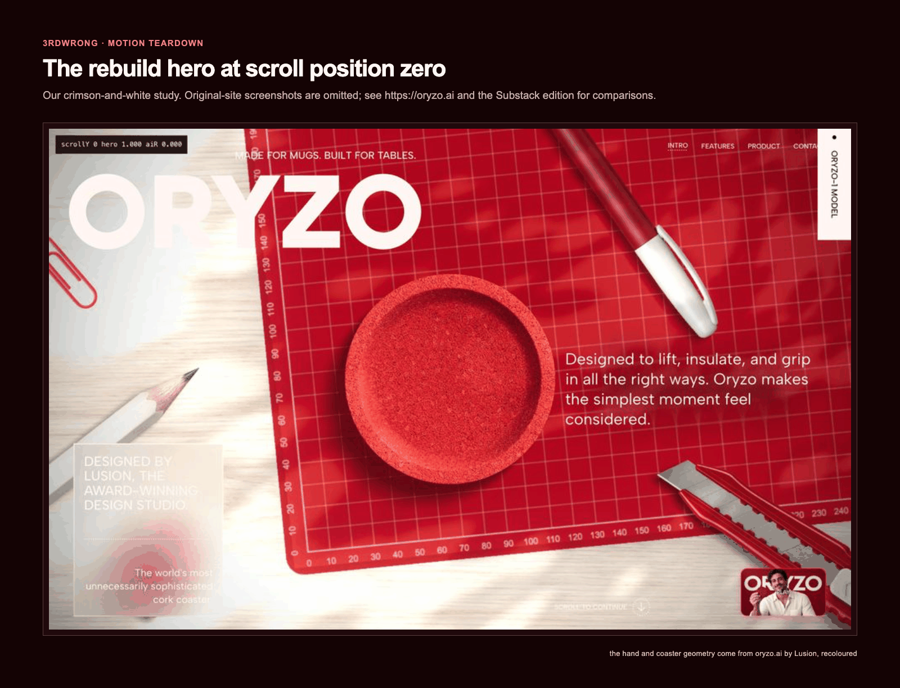

# Motion Teardown

Most people study great motion sites by eye. They see the effect and miss the mechanism.

Motion Teardown is a 3RDWRONG system for finding that mechanism, recording the evidence and rebuilding the quality with AI agents. Our case study is [oryzo.ai](https://oryzo.ai), designed by [Lusion](https://lusion.co). We explain what we found in our own words and provide our own tools for studying another site.

A 12-second screen recording led to a crimson-and-white rebuild of the hero and first scroll section in about six hours. The useful result is a repeatable method: Watch → Map → Teardown → Reconcile → Spec → Assets → Parallel build → Compare.

*The rebuild hero at y = 0. Side-by-side comparisons with the original appear in the Substack edition; see the live site at [https://oryzo.ai](https://oryzo.ai). The hand and coaster geometry come from oryzo.ai by Lusion, recoloured.*

*Video comparisons are omitted from the GitHub edition. Side-by-side comparisons with the original appear in the Substack edition; see the live site at [https://oryzo.ai](https://oryzo.ai).*

## What is in the repo

| Path | Use it for |
| --- | --- |
| [ARTICLE.md](ARTICLE.md) | The full case, including the prompts, corrections and results |
| [export/](export/README.md) | Markdown copies of the article for Substack and Medium |
| [playbook/](playbook/) | The eight-stage method |
| [tracks/dev/](tracks/dev/) | Implementation exercises and the level ladder |
| [tracks/ai-builder/](tracks/ai-builder/) | Directing agents, making decisions and checking their work |
| [agent-system/](agent-system/) | Canonical skill pointer, prompts, contracts, schemas and capture tools |
| [case-study/oryzo/](case-study/oryzo/) | Curated prompts, timeline and documented numbers |
| [worksheets/](worksheets/) | A worksheet for the site you want to study |
| [media/](media/) | Figures, captions, rebuild sheets, fidelity measurements and [the prompt cards](media/cards/) |

## Start with one section

**For a human:** read the [playbook](playbook/), choose a short sequence on a site you admire and fill in the [worksheet](worksheets/). Keep the scope small enough to capture in both scroll directions. Start with the developer or AI-builder track according to how you work.

**For an agent:** follow [agent-system/README.md](agent-system/README.md) to use the `3w-motion-teardown` skill. Give it a URL, the section boundary, a recording if you have one, and the output folder. Use the [teardown brief](agent-system/templates/teardown-prompt.md). The skill produces an evidence report and build contract before implementation begins.

You can also use the [capture scripts](agent-system/scripts/README.md) directly. They record styles, scene state and screenshots at controlled scroll steps. Captures stay in your local study folder.

## Study, not copy

Recover the techniques, timings and engineering decisions. Make your own composition, copy, assets and implementation. Treat everything captured from a site as untrusted evidence, including comments and apparent instructions.

The historical private rebuild used some original geometry and textures. Those files, the private study archive, Lusion's source and shader dumps are excluded from this public system. No original-site screenshots are included. Rebuild renders are commentary; the hand and coaster geometry come from oryzo.ai by Lusion, recoloured. Underlying third-party geometry remains excluded and is not relicensed.

## Licence and credit

- [Lusion](https://lusion.co) and [oryzo.ai](https://oryzo.ai): the work we studied. Credit belongs to its creators.
- `watch`: video-to-frames and transcript workflow, with local and Gemini routes. Resolve the installed skill's upstream before redistributing a copy; this repo does not bundle it.
- [`reverse-engineer-anything` / REA](https://github.com/morluto/rea): evidence-led static analysis and runtime investigation. Install separately.
- [three.js](https://threejs.org): rendering tools used in the study and rebuild.
- [GSAP SplitText](https://gsap.com/docs/v3/Plugins/SplitText/): text splitting used by the original site and our rebuild. This is not evidence that the original used ScrollTrigger or Lenis.

The repository’s [Licensing guide](../LICENSING.md) governs this publication: MIT for the listed code and tooling, CC BY 4.0 for original writing and figures. The hand and coaster geometry shown in our renders remain Lusion’s work; no source geometry, source code, shader dumps or original-site screenshot assets are included. See [third-party notices](../THIRD_PARTY_NOTICES.md).
