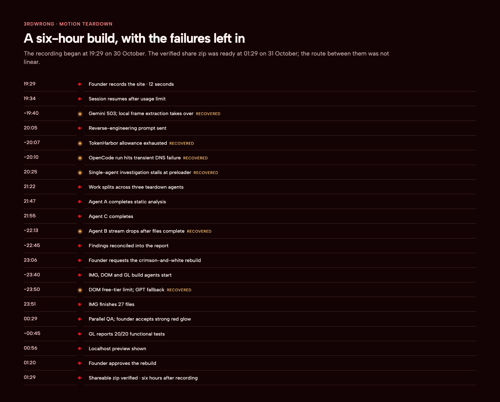

# Timeline: oryzo.ai to Oryzo Red, 30–31 October 2026

All times are IST. Sources: the session transcript digest (minute-level timestamps for every message and agent launch) and our internal facts sheet; see the note at the end. Brief numbers refer to [`prompts/`](prompts/README.md).

## Thursday 30 October

| Time | Stage | Event |
| --- | --- | --- |
| 19:29 | Watch | The founder screen-records oryzo.ai (by Lusion): 12 s, 2508×1306, 60 fps |
| before 19:34 | — | The first attempt at the session hits the Claude five-hour usage limit |
| 19:34 | Watch | The founder says "continue". The director (Claude Opus 5.5) loads the `watch` skill |
| ~19:38 | Watch | Gemini's video model returns HTTP 503 (high demand). The director extracts 36 frames locally with ffmpeg at 3 fps and reads them; nothing is uploaded. The hero card ("Designed by Lusion") identifies the site |
| 19:40 | Watch | Brief 01 to DeepSeek V4.1 Flash (free, low): link the `watch` skill into the project; save 12 key frames under descriptive names |
| 19:42 | Map | Brief 01 done and verified. `MOTION-PLAN.md` written: effects E1–E10, each a hypothesis with "must measure" items |
| 19:50–19:51 | Map | The founder asks how the motion was made. The director explains (one scroll value; effects by hypothesis; three budget tiers) |
| 19:58–19:59 | Map | The founder asks about tools and prompting. The director recommends a stack (later revised) and prompting rules: "give numbers, not adjectives" |
| 20:05 | Teardown | The founder asks for a reverse-engineering prompt for DeepSeek V4.1 Flash 1017, scoped to "the main hero section and just one or two scrolls" |
| 20:07 | Teardown | The director writes the prompt; the site is confirmed live at oryzo.ai |
| 20:10 | Teardown | The founder pastes the prompt back. Markdown has turned `__THREE_DEVTOOLS__` into bold; the director fixes it |
| 20:11 | Teardown | Brief 02 to DeepSeek V4.1 Flash 1017 via TokenHarbor (high). Fails at once: pass allowance used up; pay-as-you-go deliberately left off |
| 20:12 | Teardown | Failed task cancelled. Brief 03 (same brief, stricter context rules) to the free OpenCode DeepSeek |
| 20:21 | Teardown | Brief 03 fails: `getaddrinfo ENOTFOUND opencode.ai` (transient DNS) after partial work: capture scripts, an initial network and scene dump, two scroll probes, the first hero screenshot |
| 20:25–20:26 | Teardown | The founder: "use Claude", then "continue with DeepSeek" |
| 20:27 | Teardown | Brief 04: the same task with a resume note, reusing the files on disk |
| ~20:30–21:20 | Teardown | The single agent stalls for about 50 minutes behind the preloader: scroll stays at 0 in automation. It dumps 38 shader files meanwhile |
| 21:18 | Teardown | The founder: "how long?" Estimate: another 1–2 hours |
| 21:22 | Teardown | The founder: "speed up the process" |
| 21:23–21:24 | Teardown | The single agent is stopped, its files kept. Briefs 05, 06, 07 launch agents A (static code, no browser), B (runtime capture) and C (tokens, network, mobile, performance), all on the free DeepSeek tier |
| 21:47 | Teardown | Agent A done (about 24 minutes): the preloader gate (strict equality of loaded and total weight; no error handler), and formulas for every in-scope item |
| 21:55 | Teardown | Agent C done: `.buf` model format, network inventory, tokens, mobile, performance |
| 22:13 | Teardown | Agent B's event stream is lost at the very end. Its files are complete: 101 screenshots every 90 px, scroll physics, intro, interactions |
| 22:13–23:01 | Reconcile | The director reads A, B and C, checks contested points against the captured data, and resolves four corrections (glow, desk, hand, video). Two long replies are cut off mid-stream (22:55, 22:59) and resumed |
| 23:01 | Reconcile | `RE-REPORT.md` written: 15 sections, every claim tagged [code], [measured] or [inferred] |

## Thursday night into Friday 31 October

| Time | Stage | Event |
| --- | --- | --- |
| 23:06 | Spec | The founder asks the director to combine the video and code findings and teach how to build it. The director explains the five ideas behind the site and an ordered build path |
| 23:34 | Spec | The founder: rebuild "the exact version but in a red and white colour theme", with GPT-generated images |
| 23:36 | Spec | Four multiple-choice questions in one prompt. Answers: crimson + white; new GPT-generated props; a free substitute font; keep the ORYZO copy |
| 23:39 | Spec | `BUILD-SPEC.md` written: decisions, file ownership, the contract file, palette, assets, agent scopes, acceptance |
| 23:40 | Spec | The director extracts the hero prop placement data from the bundle (a report unknown) |
| 23:41 | Assets / Build | Briefs 08, 09, 10: IMG (GPT-6 Luna, medium), DOM (DeepSeek free, high), GL (GPT-6.1 Sol, high) |
| 23:51 | Build | DOM agent hits the free DeepSeek usage limit after scaffolding (package.json, tsconfig, Vite config, contract file, reference symlink, font, gitignore entries) |
| 23:52 | Build | Brief 11: DOM work relaunched on GPT-6 Luna (max) on a second ChatGPT account, with a resume note |
| 23:52–23:53 | Build | The old DOM task tries to auto-restart, hits the same limit, and is cancelled with its retry |
| 23:53 | Assets | IMG done: 27 files; no image regenerated; prop cut-outs reprocessed |
| 23:54 | Compare | The director checks the images on contact sheets; notes the red cork looks very bright on its own |
| 00:29 | Compare | The founder: "I need you to speed up the process." The director reads the GL agent's screenshots without waiting for its report and compares them with the original at 8 scroll positions |
| 00:31 | Compare | Finding: everything lines up except the red edge glow, which washes the screen around 6,000 px |
| 00:32 | Compare | The founder: "No, it works, I'm fine with it." The glow is kept |
| 00:34 | Build | The director notes that the max-effort DOM agent took about 40 minutes before writing its first file |
| 00:56 | Build | GL agent's report arrives: 20/20 functional tests, 24 required screenshots, 60 fps average on the M3, p95 17.2–17.4 ms |
| 01:20 | Compare | The founder: "show it to me in localhost" |
| 01:21 | Compare | The sandbox blocks local port binding; the dev server runs outside it at 127.0.0.1:5180. The director's automated screenshot times out; visual check reported as not done |
| 01:28 | Compare | The founder approves the rebuild and asks for a zip |
| 01:29 | Compare | Shareable zip built and verified to build: 4.6 MB, 92 files; private, because it contains Lusion's models |
| 01:33 | — | The founder asks for the system and guide you are reading |
| 01:41 | — | The founder's decisions on the guide: one mega guide, the side-by-side video, failures included but not prominent, prompts central |

## Elapsed time

| Span | From → to | Duration |
| --- | --- | --- |
| Whole session | 19:29 recording → 01:29 zip | 6 h |
| Reverse engineering | 20:05 request for the prompt → 23:01 report | about 3 h, of which roughly 1 h was lost to the quota, the DNS failure and the preloader stall |
| Rebuild | 23:34 red-and-white request → 01:21 running on localhost | 1 h 47 min |
| Single-agent stall | 20:27 resume → 21:23 split | about 56 min, of which about 50 behind the preloader |
| Agent A | 21:23 → 21:47 | 24 min |
| Image agent | 23:41 → 23:53 | 12 min |
| GL agent | 23:41 → 00:56 report | 1 h 15 min |

## A note on sources

An early summary of the session put several events up to half an hour too early (the report, the red-and-white request, the image agent, approval). This timeline and our internal facts sheet now both follow the transcript's minute-level timestamps and the file modification times of `RE-REPORT.md` (23:01) and `BUILD-SPEC.md` (23:39). The six-hour total (19:29 → 01:29) was never in question.
